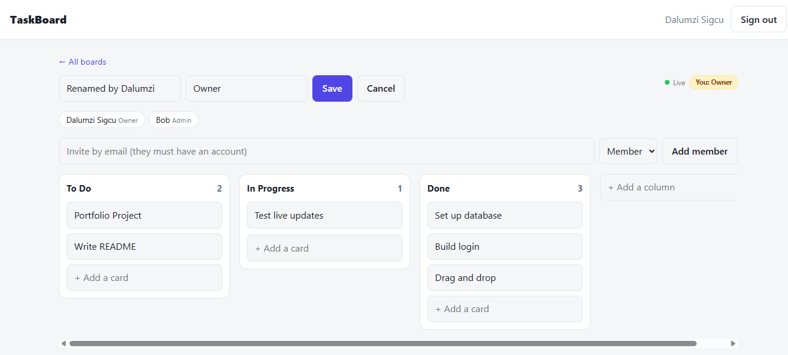
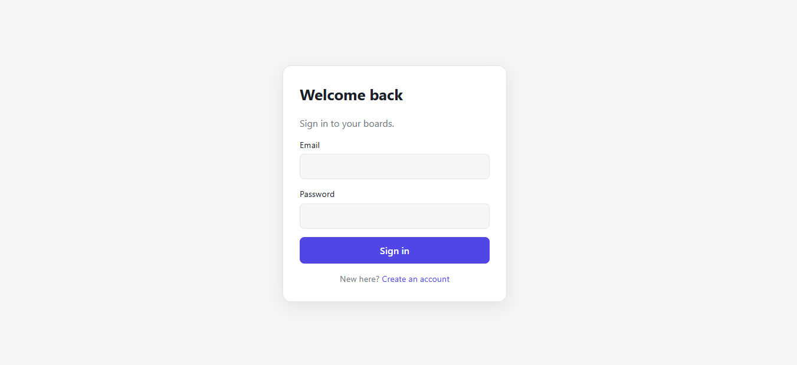
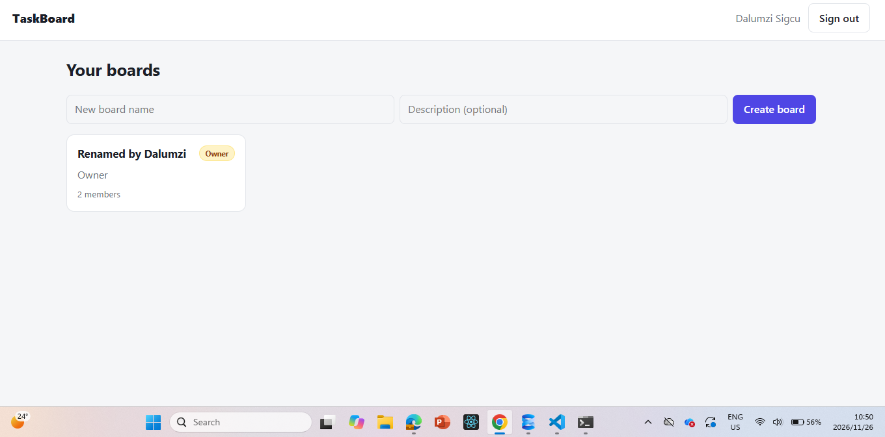

# TaskBoard

A Trello/Jira-lite task and project management app. Create boards, organise work into columns and cards, drag cards between columns, invite teammates with different roles, and watch changes appear live on everyone's screen.



## Features

- **JWT authentication:** register and sign in, with passwords hashed using BCrypt
- **Boards, columns and cards:** create and edit them from the UI
- **Drag and drop:** move cards within and between columns (dnd-kit); the order is saved on the server
- **Roles and permissions:** Viewer, Member, Admin and Owner per board, enforced by the API
- **Real-time updates:** SignalR pushes changes made by one user to everyone viewing the board
- **Card details:** description and due date
- **Smoke test:** a PowerShell script that checks the whole API end to end

## Tech stack

| Layer | Technology |
|---|---|
| Frontend | React, TypeScript, Vite, React Router, TanStack Query, dnd-kit, Axios |
| Backend | ASP.NET Core Web API (C#), SignalR, JWT bearer authentication |
| Database | SQL Server (LocalDB in development), Entity Framework Core migrations |

## Roles

| Action | Viewer | Member | Admin | Owner |
|---|:---:|:---:|:---:|:---:|
| View the board and its members | yes | yes | yes | yes |
| Create, edit, move and delete cards | no | yes | yes | yes |
| Create, rename, move and delete columns | no | no | yes | yes |
| Edit the board, add members, change roles | no | no | yes (up to Member) | yes (up to Admin) |
| Delete the board | no | no | no | yes |

Users who are not members of a board get a 404, so the API does not reveal that the board exists.

## How drag and drop is saved

Cards and columns store a floating-point `Position`. When an item is moved, it receives the midpoint between its new neighbours, so a drag updates a single row instead of renumbering the whole column. A column is renumbered only if the gaps become too small.

## Getting started

**Prerequisites:** .NET SDK, Node.js (LTS), SQL Server or SQL Server LocalDB (Windows), and the EF Core tool: `dotnet tool install --global dotnet-ef`

```powershell
git clone https://github.com/DalumziSigcu/taskboard.git
cd taskboard

# Backend
cd backend\TaskBoard.Api
dotnet user-secrets set "Jwt:Key" "replace-with-a-random-string-of-at-least-32-characters"
dotnet ef database update
dotnet run
```

The API listens on http://localhost:5090. The database connection string is in `appsettings.json` and defaults to LocalDB. The JWT signing key is kept in user-secrets, so it is never committed.

```powershell
# Frontend (in a second terminal)
cd frontend
npm install
npm run dev -- --port 5173 --strictPort
```

Open http://localhost:5173 and create an account.

## Testing

With the API running, from the repository root:

```powershell
powershell -ExecutionPolicy Bypass -File .\scripts\smoke-test.ps1
```

The script registers test users and checks authentication, role permissions, boards, columns, cards and drag-and-drop ordering.

## API overview

| Method | Route | Purpose |
|---|---|---|
| POST | `/api/auth/register`, `/api/auth/login` | Create an account, sign in |
| GET | `/api/auth/me` | Current user |
| GET, POST | `/api/boards` | List my boards, create a board |
| GET, PUT, DELETE | `/api/boards/{id}` | Read, edit, delete a board |
| POST, PUT, DELETE | `/api/boards/{id}/members[/{userId}]` | Add, change role, remove a member |
| GET, POST | `/api/boards/{id}/columns` | List columns with cards, add a column |
| PUT, DELETE, POST | `/api/boards/{id}/columns/{columnId}[/move]` | Rename, delete, reorder a column |
| POST | `/api/boards/{id}/columns/{columnId}/cards` | Add a card |
| PUT, DELETE, POST | `/api/boards/{id}/cards/{cardId}[/move]` | Edit, delete, move a card |
| WebSocket | `/hubs/board` | Real-time board updates (SignalR) |

## Screenshots




## Roadmap

- Remove-member and change-role buttons in the UI
- Card assignees in the UI
- Refresh tokens and a change-password screen
- Automated integration tests in CI
- Docker setup and deployment

## Author

Built by **Dalumzi Sigcu**: [github.com/DalumziSigcu](https://github.com/DalumziSigcu)

## Licence

MIT. See [LICENSE](LICENSE).
